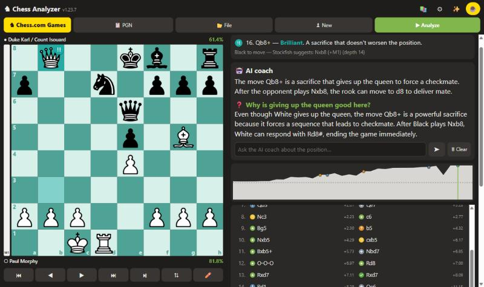
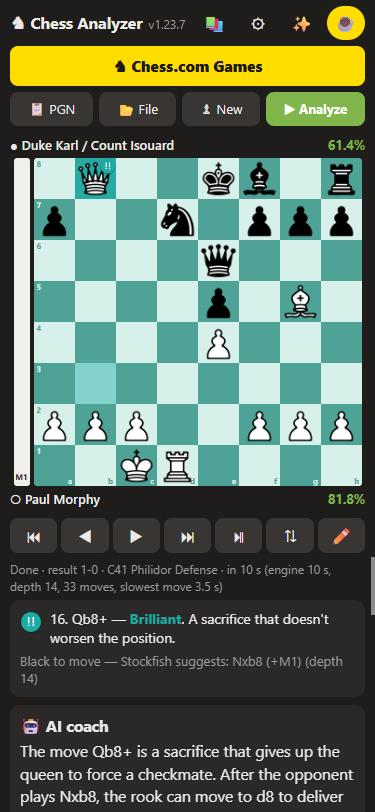
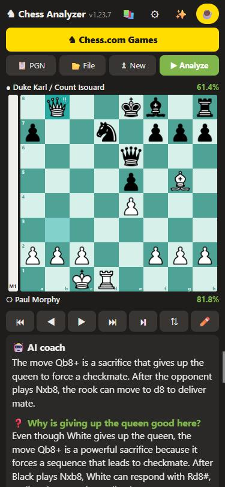
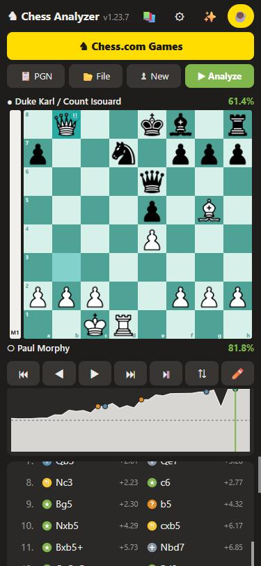

# Chess Analyzer

**Free chess game analyzer for Windows and Android**

[**⬇ Download**](https://github.com/volod4ik4-code/chess-analyzer/releases/latest)

---

Paste a game (PGN) or load your chess.com games — Stockfish 19 reviews every move like chess.com's Game Review: **Brilliant, Great, Best, Excellent, Good, Book, Inaccuracy, Miss, Mistake, Blunder**, player accuracy and an evaluation graph. No sign-up, no subscription — the analysis runs on your device.

  
  
  

## Features

- ♟ **Every move classified** with rules close to chess.com (thresholds depend on the players' ratings), game **accuracy**, evaluation graph and eval bar.
- 🤖 **AI coach** explains moves in plain language and **answers your questions** about the position ("what's the threat?", "what's the plan?") or anything else. Explanations are based on Stockfish's calculation. Offline, the regular coach is shown.
- ♞ **chess.com games** — enter a username, pick a month and a game, the analysis starts by itself.
- 🎯 **Your own lines** — move pieces on the board, Stockfish evaluates each move instantly; lines are saved.
- 📚 **lichess-style studies** — chapters, comments, arrows and circles, PGN export.
- 📖 **Opening book** (lichess) — opening names and "Book" moves, while bad opening moves are still flagged.
- ⬆ **In-app updates** — a new version installs in a few clicks.
- 🌐 English and Ukrainian, dark theme, several board colours.

## Install

**Windows 10/11**
1. Download `ChessAnalyzer-…-Windows.zip` from the [latest release](https://github.com/volod4ik4-code/chess-analyzer/releases/latest).
2. Unzip it anywhere and run `ChessAnalyzer.exe`.
3. If Windows shows "Windows protected your PC", click "More info" → "Run anyway" (this happens with apps without a paid code-signing certificate).

**Android 7+** (64-bit phones)
1. Download `ChessAnalyzer-…-Android.apk` from the [latest release](https://github.com/volod4ik4-code/chess-analyzer/releases/latest).
2. Open the file and allow installs from this source.

## Is it a virus?

No. Sometimes one or two of ~70 antivirus engines on VirusTotal report something like `BehavesLike…` — that is a **behaviour-based guess**, not a detected virus. The app runs the Stockfish engine in the background, goes online (updates, chess.com, AI coach) and can update itself, which makes some antiviruses suspicious. You can check the launcher by its SHA-256 hash:
[`8D8DE7EBB61848CD84BB3292342AEBC7C8662A6C8BC2278C13E32AFF5F74F363`](https://www.virustotal.com/gui/file/8D8DE7EBB61848CD84BB3292342AEBC7C8662A6C8BC2278C13E32AFF5F74F363)

The AI coach receives only the chess position and moves — no personal data. It can be turned off in ⚙ Settings.

## Support ☕

The app is free for everyone. If it helps you, you can support the author: monobank card **4441 1144 3726 1967**. News and updates on Telegram: [t.me/chessanalyser](https://t.me/chessanalyser).

---

Uses <a href="https://stockfishchess.org">Stockfish 19</a> (GPL-3.0, <a href="https://github.com/official-stockfish/Stockfish">source code</a>),
<a href="https://github.com/nmrugg/stockfish.js">stockfish.js</a> (GPL-3.0),
<a href="https://github.com/niklasf/python-chess">python-chess</a> (GPL-3.0),
<a href="https://github.com/jhlywa/chess.js">chess.js</a> (BSD-2-Clause),
<a href="https://github.com/lichess-org/chess-openings">lichess chess-openings</a> (CC0),
AI coach: Gemma (Google) on Cloudflare Workers AI.
Screenshots: Morphy – Duke Karl / Count Isouard, Paris 1858.

